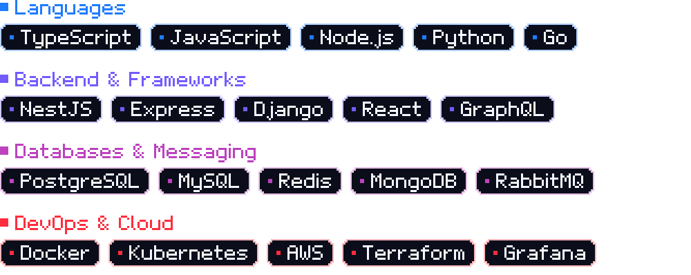
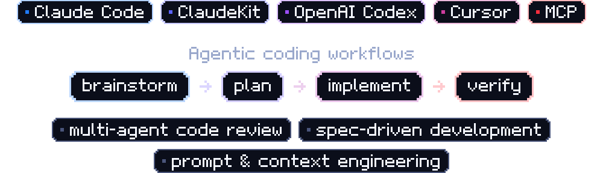

 

<!-- Profile views counter -->

## About Me

## Tech Stack

## AI-Augmented Engineering

## GitHub Stats

  

## Contribution Snake

<picture>
  <source media="(prefers-color-scheme: dark)" srcset="https://raw.githubusercontent.com/austinhoang8386/austinhoang8386/output/github-contribution-grid-snake-dark.svg" />
  <source media="(prefers-color-scheme: light)" srcset="https://raw.githubusercontent.com/austinhoang8386/austinhoang8386/output/github-contribution-grid-snake.svg" />
  
</picture>

## Connect With Me

  
  

  

